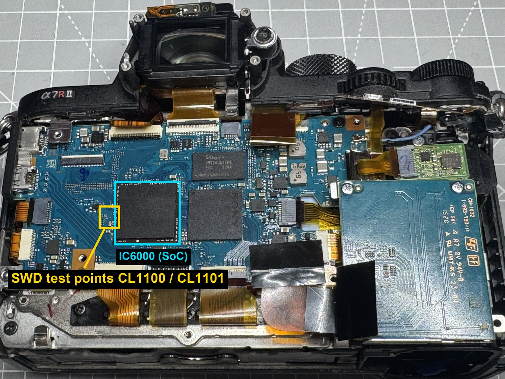
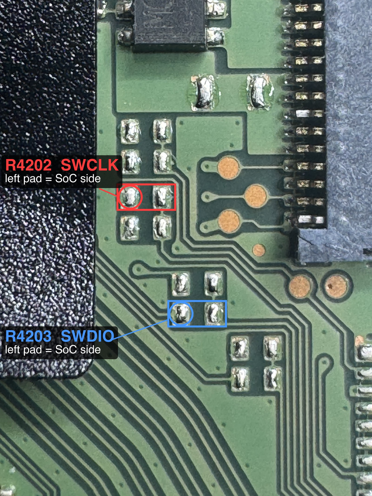

# Sony CXD90014 (BIONZ X) SWD recovery notes

Non-destructive debugging and recovery of boot-looping Sony cameras over **SWD**, using a cheap RP2040 probe (debugprobe/CMSIS-DAP), OpenOCD and PMCA's `updatershell`. On the α7R II, sewing needles on test points were enough; on the a5000, thin wires had to be soldered to two unpopulated resistor pads.

| Case | Status | Write-up |
|---|---|---|
| **ILCE-7RM2 (α7R II)**, FW 4.01: boot loop after installing a PMCA app with an XML launcher icon | ✅ **fixed** | [docs/a7rii-bootloop.md](docs/a7rii-bootloop.md) |
| **ILCE-5000 (a5000)**: boot loop after a modified firmware (clean HDMI patch) | ✅ **fixed**, back on stock 1.10; then clean HDMI done without shifting anything | [docs/a5000-bootloop.md](docs/a5000-bootloop.md) |

## What's in here
- `tools/a5000/`: the a5000 versions of the stages (a5000 Loader3/kernel addresses), stage 4a/4b (observe/force the Loader3 boot mode), version check and flash helper, WBI header backup/drop, and the size-preserving TPZL patcher plus `firmware.tar` rebuild.
- `tools/`: (α7R II) OpenOCD configs (read-only stages 1–2f, stage 3 = force the Sony updater by setting `r0` only), wrappers, log decoders (kernel `__log_buf`, persistent `klog`, Android logger), kallsyms parser, a FIFO-controlled PMCA updatershell session (macOS), an IOKit USB logger, and `check_apk.sh` (pre-install check for PMCA apps).
- `logs/a7rii/`: kernel log, klog, logcat and SWD/PMCA session logs (serials removed).
- `logs/a5000/`: SWD stages, power-on PC trace, flash attempts, WBI-drop session (serials removed).
- `docs/`: write-ups and images.

## Key findings (short)
- α7R II SWD: **CL1100 = SWCLK, CL1101 = SWDIO** (SY-1058 side A, left of IC6000). `DPIDR 0x3ba02477`, 4× Cortex-A5.
- You can read the kernel `klog` (`PA 0x834e0000`) and the Android logger (`PA 0x8345ffc0`) over the AHB-AP **while the camera runs**. Both survive warm reboots.
- PMCA app developers: **use a PNG launcher icon.** Sony's `ScalarALauncher` casts icons to `BitmapDrawable`, and anything else boot-loops the camera.
- Loader3 addresses differ between models (α7R II vs. a5000/A6000). **Always verify by read-back.**
- a5000 SWD: **R4202 = SWCLK, R4203 = SWDIO**, left (SoC-side) pad, SY-1029 side B. No round SWD test points; `CL4200`/`CL4201` are `BOOT_MODE_1`/`EVER_3.15V`. Updater check `cmp r0,#0` at `0xc01f15c0` (same as A6000).
- Version check: the updater compares against `/setting/updater/dat4` (2 bytes, minor/major). Lower it (`echo -ne '\0000\0001'`; there is no `printf`) to flash an older stock package as a normal update; avoid `mode6`, which repartitions and formats.
- **Firmware mods: never change the size of an LZPT block in `nflasha15`.** Re-encode only the changed 4 KB record.
- Boot modes (a5000): power switch = **hot boot** (2, from RAM), battery swap = **snapshot boot** (11, factory WBI image in `nflasha5`), **cold boot** = 1. Relocation/`.data` patches only appear after a cold boot; zeroing the WBI header (like `ud_wbi_drop`) makes battery-swap boots cold.

## Disclaimer
Everything here is at your own risk. Stages 3 and 4b only change a CPU register during boot (nothing persistent). Flashing and the WBI header drop do write to flash. Opening a camera, probing test points and soldering can damage it. Device dumps (BootROM/Loader/NAND) are intentionally **not** included.

## Credits
nicolvus (A6000 SWD updater approach, TPZL notes), RafalB82 (A6000 write-ups), alexscemo, ma1co (Sony-PMCA-RE / OpenMemories), Raspberry Pi debugprobe, OpenOCD.
