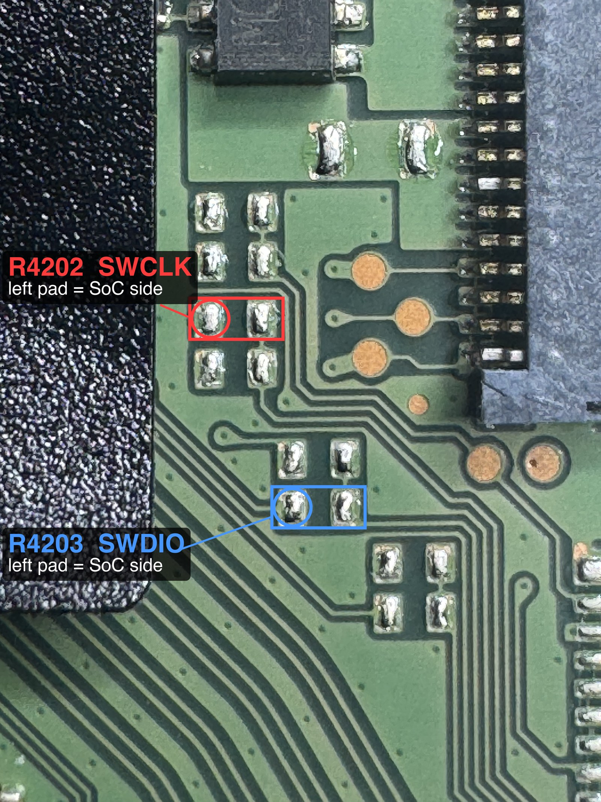
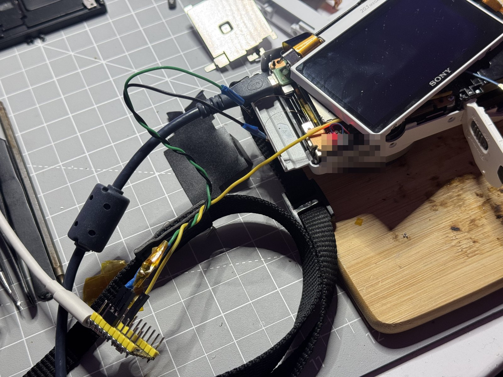
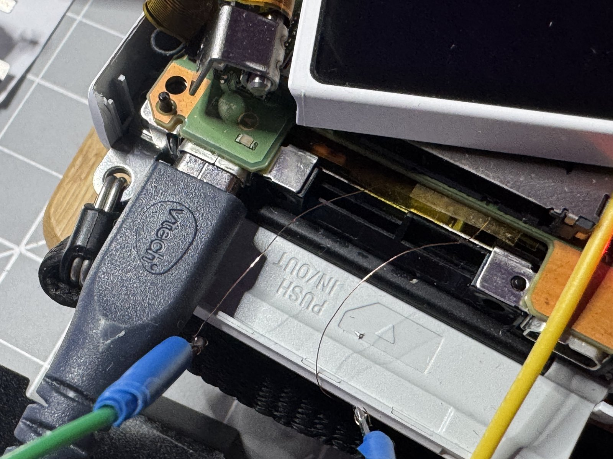
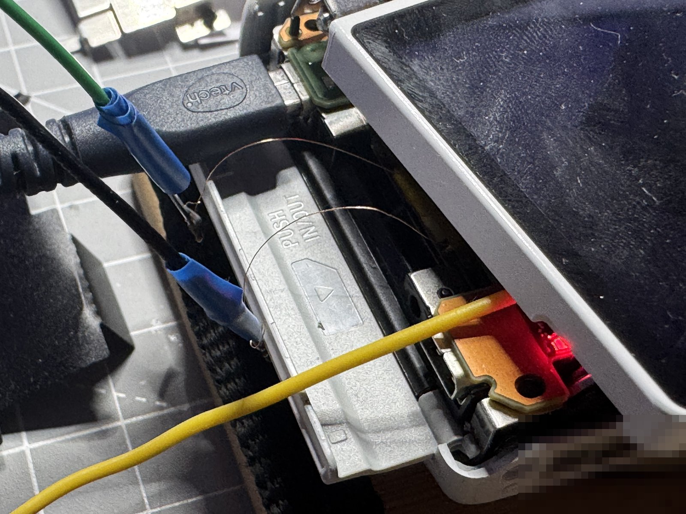
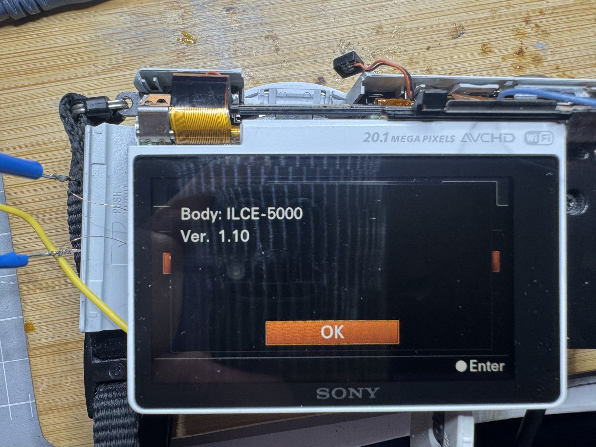
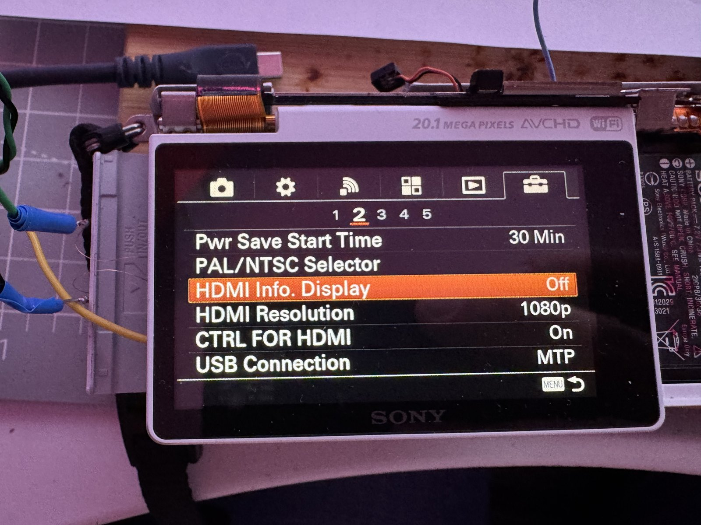

# [ILCE-5000 / a5000] Boot loop after a modified firmware: recovered over SWD, back on stock 1.10, then clean HDMI done right

**TL;DR**
- **Symptom.** After a self-built firmware 1.11 (a 2-byte patch in `/usr/lib/viewUnified2.so` to get a clean HDMI output), the a5000 restarted every ~4 s and showed no USB at all.
- **Cause.** The tool that built 1.11 repacked one 64 KB LZPT block of `nflasha15` almost uncompressed. That shifted the 614 blocks after it by 27,136 bytes, while the package still shipped Sony's unchanged warm-boot image (`nflasha5`). Details and what is proven are in [section 8](#8-the-initial-hypothesis-what-is-proven-and-what-is-not).
- **Recovery.**
  1. SWD on the unpopulated resistor pads R4202/R4203, verified read-only first.
  2. Halted core 0 in Loader3 and forced the `\updater\mode` check to "present" (`r0 := 0` at `0xc01f15c0`). The camera booted the Sony updater (USB `054c:03e2`).
  3. Set `/setting/updater/dat4` to `00 01` and flashed Sony's **unmodified** 1.10 package. The menu shows **Ver. 1.10**.
- **Clean HDMI, second attempt.**
  1. Re-encoded only the one 4 KB LZ77 record that holds the 2 bytes, so nothing shifts.
  2. The patch only shows after a real cold boot: the power switch does a hot boot from RAM, and a battery swap boots from the factory snapshot.
  3. Zeroing the WBI header (what Sony's `ud_wbi_drop.elf` does) makes Loader3 fall back to a cold boot, so the patch stays.
  4. "HDMI Info. Display" now replaces "Demo Mode" in the Setup menu and survives a battery swap.

Paths below are relative to the repo: `tools/a5000/`, `logs/a5000/`. Comments in the scripts are mostly German.

---

## 1. Background and symptoms
- **Camera:** ILCE-5000, CXD90014 (same platform as A6000 and α7R II), stock firmware 1.10.
- **Mod:** a self-built 1.11 with a 2-byte change in `viewUnified2.so`. After flashing: boot loop, display dark, no USB enumeration (not even the `054c:0994` charger HID).
- **Factory/adjust mode:** a 56 kΩ resistor between Multi Terminal `AD_JACK_IN` and `AV_GND` booted fine (cold boot, red factory test screen), but there was no USB and no UART console there either (`console=ttynull`).
- No firmware update path was reachable, so the way in was SWD, following nicolvus' A6000 recovery.

## 2. Hardware access: SWD on R4202/R4203 (SY-1029 side B)
- `SWCLK`/`SWDIO` (IC6000 W25/W26) go to the unpopulated 0 Ω footprints **R4202** (SWCLK) and **R4203** (SWDIO). There are **no round SWD test points** like `CL1100`/`CL1101` on the α7R II.
- The round pads next to the `CN4203` footprint are `CL4200` (`BOOT_MODE_1`) and `CL4201` (`EVER_3.15V`). Leave them alone.
- **Use the left (SoC-side) pad.** The right pads are joined with R4206/R4207 and go to the unpopulated header `CN4203`.
- **Wires, not needles.** Sewing needles on the tinned pads gave nothing but `JUNK` acks. Thin enamelled wire soldered to the SoC-side pads worked right away.
- **Probe:** RP2040-Zero with debugprobe v2.3.1 (GP2 = SWCLK, GP3 = SWDIO), 100 Ω in series on both lines, GND to the chassis, no 3V3. 100 kHz for the first contact. 1 MHz was later verified (50/50 identical reads).

## 3. Read-only stages
- **Stage 1** (`stufe1_identifizieren.cfg`, `logs/a5000/10_*`):
  - `DPIDR 0x3ba02477`.
  - AP0 AHB-AP (`0x44770001`), AP1 APB-AP (`0x24770002`, ROM table at `0x80000000`).
  - Four Cortex-A5 debug units at `0x80110000/2000/4000/6000`. Identical to A6000 and α7R II.
- **Stage 2** (`11_*`): `MIDR 0x410fc051`, BootROM head as on the donor.
  - The connection dropped after a few seconds. PC samples sat in Loader3's endless loop after `PWR:<<XPOWER_OFF>>`: after a battery or USB insert, Loader3 powers the camera off ("battin_off") until the switch is toggled.
- **Stage 2g** (`stufe2g_robust.cfg`, `12_*`): reads in small chunks with retries, which survives resets.
  - **All four Loader3 check blocks (56 words) in the bricked camera's RAM are identical to a donor a5000 on FW 1.10.**
  - Boot loop: about 2 s in Loader3, then about 2 s in Linux, then a reset. One cycle is about 4.2 s.
- The persistent buffers are at the same addresses as on the α7R II. This is backed by the a5000's own `kemco.txt`, which is identical in stock 1.10, the 1.11 mod and the donor: `klog.addr=0x834E0000`, `alog.addr=0x8345ffc0`.
- The a5000 kernel (FW 1.10) has its own offsets: header `e321f0d3 eb0059e5`, `log_buf_len` at `0x4037c760`, `log_end` at `0x40395290` (`stufe2b_kernel_log.cfg`).

## 4. Stage 3: forcing the Sony updater (a5000 addresses)
Taken from the donor's Loader3 and verified by read-back on the bricked camera:

| | a5000 (= A6000) | α7R II |
|---|---|---|
| `chk_updater` (`\updater\mode`) | `0xc01f159a` | `0xc01f1584` |
| `cmp r0,#0` after the file check | **`0xc01f15c0`** | `0xc01f15a2` |
| BootMode 3 | `movs r0,#3` at `0xc01f1e16` | via `set_bootmode` |
| updater loader | `0xc01f1378` | `0xc01f1362` |

`stufe3_updater_erzwingen.cfg` (`20_*`, `21_*`):
1. Poll DBGPCSR. When core 0 is in Loader3, halt it and compare four code blocks with the donor. On any mismatch it aborts.
2. Hardware breakpoint at `0xc01f15c0`: `r0 := 0`, step, re-arm. Control breakpoints at `0xc01f1e16` and `0xc01f1378`.

It worked in the first or second boot cycle every time. `054c:03e2` appeared about 35 s later (`22_*`). Only `r0` was changed.

## 5. Back to stock 1.10
- **Updater shell first, read-only:** `pmca updatershell` with the ILCE-5000 fdat (`updatershell_starten.sh`, `updatershell_steuerung.py`; macOS needs `sudo`).
  - `info` reported **1.11**: `/setting/updater/dat4` is `11 01` (2 bytes, minor/major).
  - `boot1`/`boot5` and `kemco.txt` were byte-identical to the donor. Bootloader and updater partition were never touched by the mod.
- **`touch /setting/updater/mode` does not survive leaving the shell.** The updater cleans up its flag files, so the next power cycle was the boot loop again.
- **First flash** (stock content, header 1.12) aborted at 50% with `Response error: 0x1063`, like nicolvus' first A6000 attempt (`30_*`).
  - USB stayed connected. The battery had probably dropped below 50%, so every later attempt ran on a **dummy battery with a mains adapter**.
  - After the abort the session answered everything, even `init`, with `0x1063`. The power switch does not end an updater session; only pulling power does.
  - The aborted update left `\updater\mode` behind, so the camera came up in the updater without SWD.
- **Stock 1.10 was rejected as "Invalid version"** while `dat4` said 1.11. `versionspruefung.py` checks this with `init` + `checkGuard` only, without writing (`31_*`).
- **No `mode6`.** In the a5000 `us_mkfs.sh`, version-skip mode runs `edisx.elf` and `uc_mkfs -m full`; a normal update uses `fmode=app`.
- **Instead, `dat4` := `00 01`.** Watch out: the updater's BusyBox has **no `printf` and no `hexdump`**, and `printf … > dat4` just truncates the file. Use the ash builtin: `echo -ne '\0000\0001' > /setting/updater/dat4`, then verify with `pull`.
- `flash_110.py` checks, then flashes `ILCE5000_V110_ORIGINAL.dat` unmodified: "1.00 → 1.10", 100%, Done (`32_*`). The updater wrote `dat4 = 10 01` itself. The menu shows **Ver. 1.10**.
- Tip for opened bodies: "Camera Error. Turn power off then on." right after a flash usually means a flex cable (sensor, shutter) isn't connected.

## 6. Clean HDMI without shifting anything
**What the patch does.** The 2 bytes are in `.rel.dyn` of `viewUnified2.so`. The relocation for the data pointer at VA `0x464818` refers to symbol `0x110` `cmnViewSettingNodeRootNoOsdOutputThroughHdmi` instead of `0x3d0` `cmnViewSettingNodeRootSetupDemoMode`. "Demo Mode" in the Setup menu becomes "HDMI Info. Display".

**Size-preserving rebuild** (`tpzl_patch.py`, `paket_bauen.py`):
- **Container format.** `nflasha15` is a TPZL container: header, TOC, then 64 KB blocks. Each block holds 16 × 4 KB records in Sony's LZ77 format (`0xF0`: flag byte, literals, 2-byte matches with a 12-bit distance, lengths 3–16/32/64, end marker `00 00`).
- **One record re-encoded.** Only record 11 of block 1621 holds the 2 bytes. Sony's encoding of it is 2751 bytes, mine is 2750. The block keeps its size (`0x9800`); header, TOC and all other blocks stay byte-identical.
- **Content verified.** fwtool's own decoder gives back the stock ext2 plus exactly those 2 bytes.
- **Package rebuilt.** `firmware.tar` is rebuilt with only `dev/nflasha15` and its CRC in `part_image.sum` changed (identity test: byte-identical to the original).
- **Packing chain verified.** Packing the stock tar with fwtool reproduces `ILCE5000_V110_ORIGINAL.dat` **byte for byte**.
- **Flashing.** Labelled 1.10, with `dat4` lowered to `00 01` again. One transfer stalled at 30% with the camera idle and needed a full power removal. The next one went through in 2 minutes (`40_*`, `41_*`).

**Why the menu still said "Demo Mode".** Relocations are applied when a process starts fresh, and this camera almost never does. Measured with `stufe4a_modus_beobachten.cfg` (breakpoints on `set_bootmode` `0xc01f1544`, `get_bootmode`, kernel start):

| situation | Loader3 mode | meaning |
|---|---|---|
| power switch OFF → ON | **2** ("chk hotboot") | resume from RAM, the switch doesn't really power off |
| after pulling the battery | **11** ("chk ssboot") | boot from the WBI image in `nflasha5` |
| default at the end of mode selection | **1** | real cold boot |

The image in `nflasha5` is Sony's prebuilt factory image. The **donor's** `nflasha5` (a used camera) is still byte-identical to the one in the update package, so normal use never rewrites it.

**Proof.** `stufe4b_kaltstart_erzwingen.cfg` changes `r0` to 1 when `set_bootmode` is called from mode selection (`lr 0xc01f2153`), see `52_*`. After that boot the menu showed "HDMI Info. Display".
- BootROM → Loader2 → Loader3 takes about 10 ms after power-on (`51_*`, PC trace), so the halt is often too late. It took five tries at 1 MHz.

**Making it permanent** (`wbi_test.sh`, `60_*`):
- `ud_wbi_drop.elf` just writes 512 zero bytes to the start of the type-2 partition from `partinf.conf`, which is `nflasha5` "Warm Boot Image" (60 MB).
- Loader3's warmboot and ssboot checks both need a `WBI1`/`WBI0` header (`0xc01f2bc6`/`0xc01f2be6`). Without one, mode selection falls through to **mode 1**.
- Procedure in the updater shell:
  1. Back up all of `nflasha5` (pull, 60 MB) and keep a copy of the header sector on `/setting`.
  2. `dd if=/dev/zero of=/dev/nflasha5 bs=512 count=1`, then read back to verify.
- **Result.** Hot boots stay fast. After a battery swap the camera cold boots (roughly 15 s, noticeably slower) with the patch active. "HDMI Info. Display" survives pulling the battery, and the HDMI output is clean with it set to Off.
- **To undo:** write the header back (`wbi_test.sh rueckweg JA`), or flash any package that rewrites `nflasha5`.

## 7. Lessons
- **Never let a firmware patch change the size of an LZPT block.** Re-encode only the changed record with Sony's LZ77 format, and check the block still fits its 512-byte-aligned slot.
- **A patch can be correct and still invisible.** Hot boot and snapshot boot keep the old process state. Relocation and `.data` changes need a cold boot.
- **Read-only first, verify addresses by read-back.** The a5000 Loader3 matches the A6000 at the key addresses but is not byte-identical, and the α7R II differs.
- **Power:** flash on a dummy battery with a mains adapter. In updater mode only pulling power ends a stuck session.
- **The updater's BusyBox is minimal.** Check that a command exists before redirecting into a file.

## 8. The initial hypothesis: what is proven and what is not
The hypothesis from the start: *the 1.11 package shifted LZPT blocks in `nflasha15`, while the unchanged warm-boot image in `nflasha5` still expected the old layout.*

**Proven (A/B, same camera, same stock `nflasha5`):**
- The 1.11 package (block 1621 grown to `0x10200` bytes, 614 blocks shifted by 27,136 bytes) → boot loop. Every cycle is Loader3 then about 2 s of Linux, then a reset.
- The new package with **the same 2-byte patch and the same stock `nflasha5`**, but block 1621 kept at `0x9800` bytes (nothing shifted) → boots normally, both via snapshot boot (mode 11) and hot boot (mode 2).
- So the **resized block and the shift it caused** are what broke the camera. The patch content itself was harmless.

**Not separated:** two mechanisms remain, and the old mod triggered both at once.
1. A stale image: snapshot RAM state, such as a cached TOC, that points to the old block offsets.
2. The oversized, almost uncompressed block 1621 itself. nicolvus saw the hardware LZ decoder fail (`LDEC ERR -10003`) on blocks grown with raw `0x0F` records.

Telling them apart would need the old shifted 1.11 package booted cold, without a valid WBI header, or a shifted but properly compressed block. I'm not doing that experiment on this camera now that the SWD wires are removed. For building mods it doesn't matter: keep every block at its original size and both risks are gone.

## Files
`tools/a5000/` (OpenOCD 0.12, debugprobe):

| file | purpose |
|---|---|
| `stufe1_identifizieren.cfg` | DPIDR, APs, ROM table (read-only) |
| `stufe2_nur_lesen.cfg`, `stufe2g_robust.cfg` | registers, BootROM, Loader3 check blocks; 2g survives resets |
| `stufe2b_kernel_log.cfg`, `stufe2c_klog_alog.cfg`, `stufe2d_normal_schleife.cfg`, `stufe2f_alog_stueckweise.cfg` | kernel `log_buf`, `klog`, logcat (a5000 addresses) |
| `stufe2e_pc_verlauf.cfg`, `stufe2h_pc_start.cfg` | PC traces (all cores / power-on timeline) |
| `stufe3_updater_erzwingen.cfg`, `stufe3_starten.sh` | **writes `r0` only**: force the Sony updater |
| `stufe4a_modus_beobachten.cfg`, `stufe4b_kaltstart_erzwingen.cfg` | observe the boot mode / force a cold boot (writes `r0` only) |
| `start_stufe.sh`, `warte_stufe*.sh`, `pruefbloecke.py` | wrappers; stage 3/4b only with `JA` |
| `updatershell_starten.sh`, `updatershell_steuerung.py` | FIFO-controlled `pmca updatershell` (macOS, sudo) |
| `versionspruefung.py`, `flash_110.py` | check / flash a package (`init` + `checkGuard` first) |
| `wbi_test.sh` | back up `nflasha5`, drop / restore the WBI header |
| `tpzl_patch.py`, `paket_bauen.py` | size-preserving TPZL patch, rebuild `firmware.tar` |

The wrapper scripts expect pmca and its Python venv at fixed paths (`~/Downloads/a5000-hdmi-mod/tools/...`). Adjust them for your setup.

`logs/a5000/`: SWD stages 1/2/2g/3/4a/4b, the power-on PC trace, USB, the flash attempts, and the WBI-drop shell session. Serials are removed.

Device dumps, firmware packages and backups are intentionally not included.

## Credits
nicolvus (A6000 SWD updater approach, TPZL notes), RafalB82 (A6000 write-ups), alexscemo (discussion in ma1co/Sony-PMCA-RE#752), ma1co (Sony-PMCA-RE / fwtool), Raspberry Pi debugprobe, OpenOCD.

---

<b>Kurzfassung (Deutsch)</b>

- **Problem:** Eine selbst gebaute Firmware 1.11 (2-Byte-Patch für Clean HDMI) führte zur Bootschleife ohne USB. Beim Packen wurde ein LZPT-Block fast unkomprimiert neu geschrieben. Dadurch verschoben sich 614 Blöcke in `nflasha15`, während Sonys Warmstart-Abbild unverändert blieb.
- **Rettung:**
  1. Drähte an R4202/R4203 löten, jeweils an das linke Pad (Prozessorseite). Nähnadeln funktionierten dort nicht.
  2. Per SWD `r0 := 0` an `0xc01f15c0` setzen. Die Kamera startet dann im Sony-Updater.
  3. In der updatershell `dat4` auf `00 01` setzen (mit `echo -ne`, denn `printf` fehlt).
  4. Die unveränderte Sony-1.10 flashen. Im Menü steht danach Ver. 1.10.
- **Clean HDMI:**
  1. Nur den betroffenen 4-KB-Record neu kodieren. Es verschiebt sich nichts.
  2. Der Patch wirkt erst nach einem Kaltstart: Schalter = Hot Boot (Modus 2), Akkuwechsel = Abbild-Start (Modus 11).
  3. Den Kopf von `nflasha5` nullen, wie Sonys `ud_wbi_drop`. Dann startet die Kamera nach einem Akkuwechsel kalt (etwa 15 s), und „HDMI-Infoanzeige“ bleibt dauerhaft.
- **Hypothese:** Die Ursache war die Blockvergrößerung samt Verschiebung, das ist per A/B-Vergleich belegt. Offen bleibt, ob das veraltete Abbild oder der übergroße Block selbst die Kamera zum Absturz brachte.

